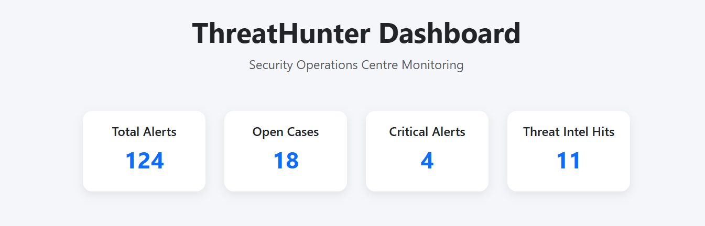
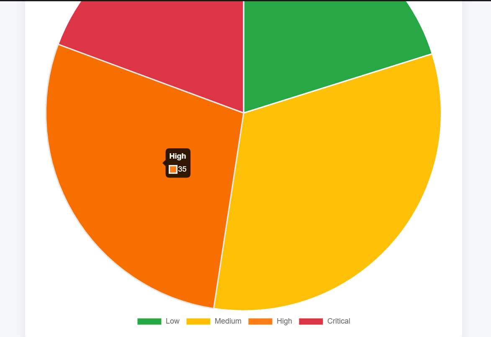
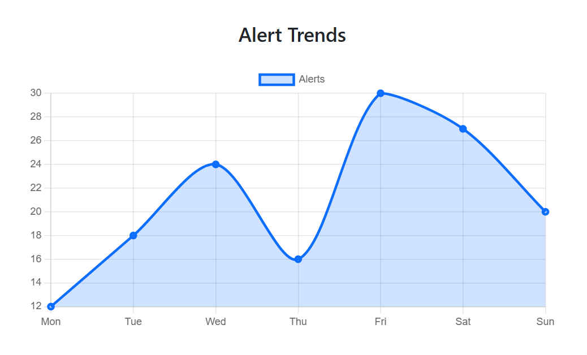
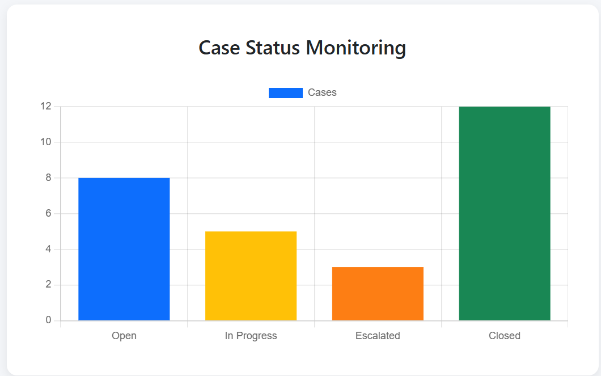
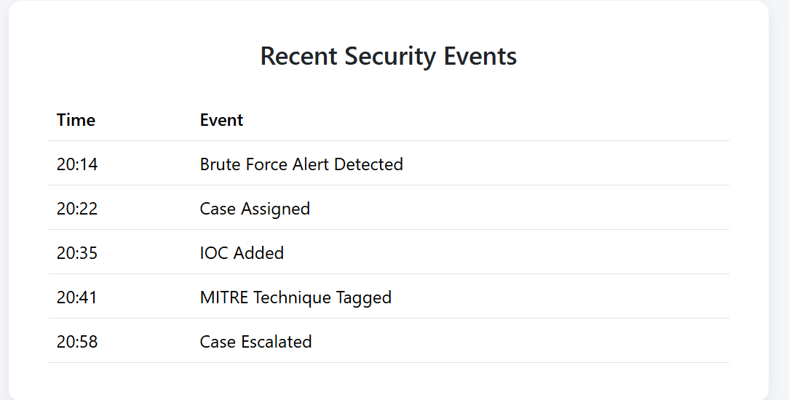
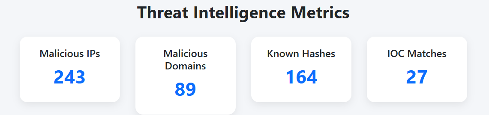

# ThreatHunter Dashboard

A SOC monitoring dashboard built with Python, Flask, Bootstrap and Chart.js. This is the MVP: it shows the dashboard layout, metrics and charts using built-in sample data. Live data from my other security tools will be connected in a later version.

## Features

- **Metric cards:** total alerts, open cases, critical alerts and threat intelligence hits
- **Severity distribution:** pie chart of alerts by severity
- **Alert trends:** line chart of alerts over the week
- **Case status monitoring:** bar chart of Open, In Progress, Escalated and Closed cases
- **Recent security events:** a table of the latest SOC activity
- **Threat intelligence metrics:** malicious IPs, malicious domains, known hashes and IOC matches

## Screenshots

### 1. Dashboard layout


### 2. Severity distribution


### 3. Alert trends


### 4. Case status monitoring


### 5. Recent security events


### 6. Threat intelligence metrics


## Running it locally

```bash
git clone https://github.com/Maliyka-L/ThreatHunter_Dashboard.git
cd ThreatHunter_Dashboard
python -m venv venv
venv\Scripts\activate        # Windows
# source venv/bin/activate   # macOS / Linux
pip install -r requirements.txt
python app.py
```

Then open http://127.0.0.1:5000 in your browser.

To turn on Flask debug mode while developing, set `FLASK_DEBUG=1` first. It's off by default because Flask's debugger can run code.

## How it works

- The sample data is defined once in `app.py`, and the metric cards are worked out from the same data as the charts, so they always match
- Flask passes the data to the template, and Chart.js draws the charts
- Chart.js is pinned to a specific version rather than always loading the latest

## Project structure

```
ThreatHunter_Dashboard/
├── app.py
├── requirements.txt
├── screenshots/
├── static/
│   └── style.css
└── templates/
    └── index.html
```

## Future improvements

- Connect to live data from Investigation Manager, Alert Engine and the Threat Intelligence module
- Auto-refresh
- Filtering by date range and severity
- Top MITRE ATT&CK techniques and cases per analyst

## Licence

MIT
